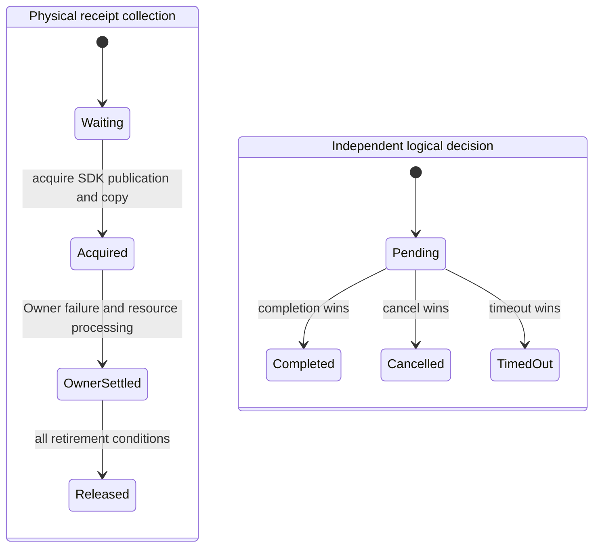

# Native environment lifetime during cancellation

This chapter defines control requests, physical completion, Owner collection, and environment retirement for source language `0.5` and the native completion ABI. It refines [async](../language/async.md), [native interoperability](../language/native-interop.md), and [Future observation](../language/future-observation.md). MUST, MUST NOT, and MAY express requirements, prohibitions, and permitted choices.

The contract assumes valid ABI declarations and pointers, provider pinning and publication, and supported Owners and targets. Version and size checks do not prove pointer validity. Arbitrary native memory corruption, escaping foreign exceptions, and forced process termination do not guarantee cleanup.

## NLS01 Objects and ownership

| Object                            | Identity and ownership                                                                    | Retirement condition                                                                                                          |
| --------------------------------- | ----------------------------------------------------------------------------------------- | ----------------------------------------------------------------------------------------------------------------------------- |
| Physical native operation         | Work actually started by the SDK, possibly before admission of a runtime wait.            | Actual call return or the specified completion publication; a cancellation request is insufficient.                           |
| Completion carrier `c`            | SDK-owned v1, v2, or v3 metadata shared by distinct admitted waiters.                     | The producer's last access and the end of all admitted consumer accesses. The SDK contract identifies allocator and releaser. |
| Wait receipt `w`                  | One runtime-admitted wait, with Future identity, terminal decision, and collection state. | Physical collection, required result and failure processing, and retirement of references, dependencies, ledgers, and roots.  |
| Managed environment `e`           | Task arguments, captures, continuations, call contexts, and GC roots.                     | All native, callback, and managed users have ended the accesses requiring that environment.                                   |
| Callback environment and receipts | An admission gate and already admitted entry or result receipts.                          | Physical call return, closed admission, and settlement of admitted receipts.                                                  |
| Callback control block            | Gate and identity metadata for an entry capability passed to native code.                 | Proof that no later capability access remains, or the specified conservative retention needed to reject that access safely.   |
| Wake target `q`                   | A native notification target that retains neither managed values nor the SDK carrier.     | Runtime detachment, completion of active accesses, and release of retained references.                                        |
| User handle                       | A file, database, socket, or other explicitly closed resource.                            | Its SDK's physical Owner, user, and close contract. GC and Future cancellation do not replace close.                          |

Releasing one environment root does not imply collecting a captured value. Values reachable through another Future or class alias MUST remain retained by their independent roots.

## NLS02 Independent state axes

Do not model lifetime as a single `Pending -> Cancelled -> Freed` sequence. Use the following independent abstract axes; their representation is not prescribed.

| Axis                      | States                                                               | Meaning                                                                                                                                                     |
| ------------------------- | -------------------------------------------------------------------- | ----------------------------------------------------------------------------------------------------------------------------------------------------------- |
| Logical decision `L(w)`   | `Pending`, `Completed`, `Cancelled`, `TimedOut`                      | The single winner at the runtime resolution point. Completed means a successful or ordinarily failed result is available.                                   |
| SDK publication `S(c)`    | `Running`, `Published`                                               | Whether the producer has performed publication after its last payload access.                                                                               |
| Receipt collection `K(w)` | `Waiting`, `Acquired`, `OwnerSettled`, `Released`                    | Acquire and necessary copying, required Owner processing, and eventual retirement are separate stages.                                                      |
| Dedicated helper `J(w)`   | `NotStarted`, `Running`, `Joined`, or `NotApplicable`                | Return and join of a runtime-owned per-operation helper. A shared reactor is joined during wake teardown; SDK-owned threads follow their provider contract. |
| Callback lifetime `B`     | `Prepared`, `Open`, `Closed`, `Settled`, plus admitted receipt count | Admission and the completion of already admitted users are separate.                                                                                        |
| Environment users `U(e)`  | Users, roots, and dependencies                                       | Entities that may still access the environment; logical cancellation does not remove them.                                                                  |
| Wake lifetime `W(q)`      | `Attached` or `Detached`, retained references, active accesses       | Runtime detachment is distinct from references held by the producer.                                                                                        |

Once `L(w)` is decided, later control or publication MUST NOT select a different winner. A concrete terminal field later becoming `SETTLED` is a storage stage, not permission to erase the decision or change it to Completed.

SDK publication, runtime `physical_done`, helper return, and callback return are different events. A completion receipt copies the required published result before publishing runtime `physical_done`. A helper can still execute its wake tail after publishing `physical_done`.

The completion winner may be claimed after copying but before runtime physical completion is published. A control request rejected in that interval does not establish Owner collection, wake-tail return, or permission to release the environment.

## NLS03 Completion receipt transitions

| Event                  | Precondition                                                                 | Required effect                                                                                                                                                         |
| ---------------------- | ---------------------------------------------------------------------------- | ----------------------------------------------------------------------------------------------------------------------------------------------------------------------- |
| Start SDK operation    | SDK admission and ownership requirements hold.                               | Set `S(c)=Running`. A later full runtime admission queue does not make this operation disappear.                                                                        |
| Admit a wait           | Pin a valid carrier and satisfy runtime and Owner requirements.              | Create distinct `w` with `L=Pending`, `K=Waiting`; register a notification target when needed.                                                                          |
| Cancel or timeout wins | The runtime has not resolved the Future or accepted a prior control request. | Select Cancelled or TimedOut once and publish the provider control request. Do not advance physical, collection, join, or callback state.                               |
| Publish SDK completion | Last payload access has finished; this generation is published exactly once. | Set `S=Published`. The producer never accesses the carrier again. A delayed v2/v3 notification uses only its retained target.                                           |
| Acquire publication    | The carrier is still valid and the required acquire observes publication.    | Copy required values into runtime-owned storage and set `K=Acquired`. Select completion only if the logical decision remains pending.                                   |
| Owner collection       | `K=Acquired`, with a dedicated helper joined when required.                  | Process necessary failures, cleanup, credits, and ledgers; set `K=OwnerSettled`. Discarding an unused result does not skip required failure handling or physical drain. |
| Observe a result       | The Owner can safely deliver the result.                                     | Apply the Future observation rules. Retiring an observed parent ledger does not retire a surviving Future alias or result root.                                         |
| Retire a receipt       | The object-specific NLS07 conditions hold.                                   | Set `K=Released`; release credits and references exactly once and preserve results required by remaining aliases.                                                       |

A receipt cancelled before publication still follows `Waiting -> Acquired -> OwnerSettled`. A correctly admitted wait on an already published carrier can acquire immediately. Completion of one waiter does not substitute for collection by other admitted waiters.

These machines are independent: Cancelled and TimedOut do not provide a shortcut to Released. The diagram shows ordinary admitted receipt collection, not abandonment of preparation before an operation exists. Optimized representations must preserve the same public lifetime conditions.

## NLS04 Native call and callback transitions

A call-lifetime native invocation has the following stages. These differ from the operation behind a returned completion carrier: the native function can return a carrier while `S(c)` is still Running.

| Stage                 | Permitted work and next condition                                                                                                                                                                         |
| --------------------- | --------------------------------------------------------------------------------------------------------------------------------------------------------------------------------------------------------- |
| `Prepared`            | Prepare arguments, buffers, roots, and callback controls. Abandon before entry only after establishing that no callback or other physical user was admitted.                                              |
| `Entered`             | Check Owner and ABI, enter native code, and retain published capabilities and environments. Cancellation cannot fabricate physical return.                                                                |
| `Returned`            | Confirm physical native return. Keep already admitted callbacks and result receipts.                                                                                                                      |
| `Closed`              | Close admission of new callback entries while retaining already admitted receipts.                                                                                                                        |
| `Settled`             | Confirm receipt and required queue settlement. Commit native record loans and consume a permitted return owner.                                                                                           |
| `Read` and retirement | Read or convert the result under its ABI and pass managed values to independent roots. Retire call environments only under NLS07. Required release also precedes propagation of result-conversion Errors. |

Abandoning Prepared work applies only when physical users were never created. An unsubmitted wait receipt for an already running SDK operation does not meet that condition; a drain owner must remain.

Closed admission and drained receipts do not imply that the callback control block itself can be freed. A closed-consumer proof of no later capability access permits retirement after physical return and receipt settlement. Unknown consumers retain the specified conservative lifetime. Keeping a rejection guard does not permit persistent capturing callback registration.

Late entry is distinct from admitted receipt drain. An entry violating the closed call-lifetime protocol is a protocol fault and need not become a recoverable ordinary Error.

## NLS05 Publication and carrier retirement

For v1, publication is a release store to `done` after the producer's last payload access. For v2/v3, publication is the final atomic exchange of `notification` to DONE. `base.done` alone MUST NOT authorize v2/v3 retirement. A v3 scalar result is written before that exchange.

On macOS arm64 and Linux x86_64, a v1 carrier is a 16-byte C object with
four-byte alignment. An SDK may embed it at a four-byte aligned field address
and passes that field's address to the runtime. The SDK retains the enclosing
allocation through the carrier's pin interval. v2 and v3 carriers require
eight-byte alignment for their extended fields.

An SDK with a pending notification may include another carrier publication in
it when the final exchanges return the same native target. Every covered
publication must complete before the SDK invokes the retained notification.
The SDK may release the duplicate reference once the batch retains another
reference to that target. The retained reference must survive the notification
call and be released once after it returns. Each carrier still has a separate
publication and pin interval. Each admitted receipt acquires its own publication
and preserves its own completion or control decision.

Consumers acquire publication before reading the payload and copy needed data into runtime-owned storage before publishing receipt `physical_done`. Later awaits of the same Future use retained results rather than rereading a retired carrier.

Publication ends producer access; it does not end the subsequent consumer reads and copies. Freeing, reinitializing, or reusing a carrier requires all of the following:

1. The producer's last access and required publication have completed.
2. Every admitted waiter for that generation has finished its publication acquisition, required copies, and carrier accesses.
3. Registrations, validation, cancellation, timeout, and the usage periods of pointer copies that can perform those accesses have ended.
4. The provider and caller ownership contract prevents new access to the old generation.

The SDK contract identifies who establishes these conditions. The runtime does not infer an arbitrary SDK allocator or all its references. A new carrier generation is distinct from reawaiting an existing Future.

A v2/v3 carrier has one runtime notification Domain. Multiple waits in that Domain may share registration. This does not permit registration by another Domain or producer carrier access after the final exchange.

A registrar MUST retain its candidate target before attempting the Empty-to-Target CAS. Only a winning CAS transfers that reference. A losing CAS against the same target or DONE MUST return only its candidate reference; it does not consume the SDK's previously transferred reference. The final SDK exchange captures that reference only when it replaces a target. Publication from an unregistered slot creates no native notification reference, and a later registrar MUST NOT replace DONE with a target. Each admitted receipt still acquires and copies the published result.

Registration return may follow SDK publication and producer-reference release. A CAS-success flag observed at that boundary describes the CAS outcome; it does not promise that the carrier is still unpublished or that the producer reference remains live. Registration and outstanding pointer access periods remain subject to the carrier pin in this section. Runtime detachment and storage reuse do not consume outstanding references held by another generation.

### Publication and acquisition order

The v2/v3 registration CAS release-publishes the initialized target and its
retained reference. The SDK's exchange acquires a captured target before using
it. The SDK sequences payload writes before the release side of its final
exchange. Each runtime reader acquires DONE on the notification slot before
reading those bytes. Observing the diagnostic prefix alone leaves the producer's
final carrier access outstanding.

When another thread receives the physical receipt, publish the copied result
through a release/acquire boundary or an equivalent synchronization path. The
SDK notification and producer join may occur after this receipt has been copied
and observed. The acquisition of publication must already suffice for the copy.

## NLS06 Control API and races

For supported Main Futures, the Bool returned by `rinzu.future.cancel` and `rinzu.future.timeout` reports whether the runtime accepted a new control request. True does not establish physical completion. A later request for an already controlled or completed Future returns false.

If SDK publication races with runtime recognition and control, either completion or control can win at the resolution point. The contract does not fix the same winner across executions. The implementation MUST preserve one decision and MUST NOT overwrite an established completed result with a later control request.

Timeout is a control request, not forced native interruption or a finite-time return guarantee. Cancelled and TimedOut decisions are delivered through the cancellation control-failure route, distinct from ordinary Errors. This API does not imply an ordinary Timeout Error or automatic timer registration.

`isReady` does not discharge observation responsibility. It queries completion information known to the runtime and MAY advance that information. A surviving OwnerSettled Future returns true. A control request alone MUST NOT make an uncompleted physical operation ready. Between publication and Owner collection, readiness follows the completion information recognized by the runtime.

False does not prove that the SDK is still running. True does not authorize closing a user handle or prove helper and wake return. No duration bound is specified for the query or a subsequent await.

## NLS07 Object-specific release conditions

| Object                              | Required conditions                                                                                                                                                                                              | Insufficient substitutes                                                            |
| ----------------------------------- | ---------------------------------------------------------------------------------------------------------------------------------------------------------------------------------------------------------------- | ----------------------------------------------------------------------------------- |
| Carrier                             | NLS05 producer, all waiter, registration, and control accesses have ended, with old-generation admission closed.                                                                                                 | A cancellation winner, v2/v3 base.done, or collection of only one waiter.           |
| Receipt or Future record            | Physical collection of started work, required join and failure/resource handling, and retirement of references, dependencies, and roots.                                                                         | Handle unreachability or deletion of an observed parent ledger.                     |
| Native call environment             | Physical return, closed callback admission, settled admitted receipts, and no remaining environment reader.                                                                                                      | Parent cancellation or closed admission alone.                                      |
| Callback control block              | Proof of no later capability access, or the required conservative retention of rejection metadata.                                                                                                               | Body-environment release, closed admission, or a zero admitted-receipt count alone. |
| Managed task environment            | End of native, callback, and continuation accesses, with required child transfer or drain. Keep independent roots for aliased captured values.                                                                   | Parent return, entry into parent finally, or an infallible Future.                  |
| Runtime wake attachment and context | Acquire required SDK publication, drain every admitted copy, synchronize active notifications and worker wake users, and detach. Complete required joins before the caller releases a helper-accessible context. | physical_done alone; a publisher can still be in its wake callback.                 |
| Retained wake target                | Keep the target until its last native reference and active access end. Detached notify does not access freed runtime or context.                                                                                 | Retirement of the runtime itself.                                                   |
| User handle                         | Await or drain its users and perform its SDK's close on the required Owner.                                                                                                                                      | GC, a control request, or starting parent finally.                                  |

A surviving Future alias must retain the same result or failure after its observed parent ledger is retired. Conversely, unreachability MUST NOT count as observing an ordinary failure. Suppression of an expected cancellation or shutdown primary MUST NOT silently suppress additional cleanup Errors.

A worker-owned wake environment MAY be destroyed by that worker after its final environment access, before the caller observes thread join. This requires a no-further-access boundary, not merely physical completion of a receipt. Required worker joins MUST still complete before shutdown returns. A native notification target that retains only a channel sender can outlive that environment, provided it cannot access the environment or detached runtime. This does not permit early caller release of an externally owned helper-accessible context.

### Managed paths to settled Futures

A Future reachable through a rooted managed graph retains its immutable
completion. Reachability includes captured closures, their aggregates, and
cycles reached through those objects. Complete parent-ledger observation and
retire native resources at their own release boundaries. A rooted alias can
read the cached completion after carrier, environment, and target release.
After the last root and physical pin end, unreachable managed cycles and
their eligible Future records can be collected together.

## NLS08 Cleanup and Root completion

Cancel and shutdown bypass ordinary Error catches. Execute required finally blocks that were entered, and do not skip required cleanup waits or children solely because control is requested again. Preserve cleanup failures. A queued body that never entered does not execute finally blocks inside that body.

Interrupting the current task's await does not remove the target's physical users. Retain or transfer required roots and drain ownership. The contract does not require every native operation to stop before parent finally begins.

Natural Root completion waits for accepted work and required physical settlement. Explicit shutdown does not permit releasing unfinished physical users. Ordinary function return does not imply joining all Futures; parent finally may precede child cleanup. Handle owners must explicitly await or drain users before close.

A full normal admission queue MUST NOT lose drain ownership for an SDK operation already started. Preserve an admitted drain through a reserved route or retained deferred receipt instead of treating admission failure as physical completion.

## NLS09 Safety invariants

| ID     | Invariant                                                                                                                                                                                                        |
| ------ | ---------------------------------------------------------------------------------------------------------------------------------------------------------------------------------------------------------------- |
| NL-I1  | A decided logical winner does not change because of later control or publication.                                                                                                                                |
| NL-I2  | An Acquired completion receipt implies acquired SDK publication and all required result copies.                                                                                                                  |
| NL-I3  | Control winning alone does not imply SDK publication, receipt acquisition, helper join, or callback settlement.                                                                                                  |
| NL-I4  | Carrier free or reuse follows the end of producer and all consumer accesses. After publication, the producer accesses only its retained wake target.                                                             |
| NL-I5  | Environment release follows all required physical accesses and preserves roots for surviving managed values. Callback controls separately require proof of no later capability access or conservative retention. |
| NL-I6  | Do not free a helper's Future record or wake context while that helper can still access it. physical_done and thread return are separate.                                                                        |
| NL-I7  | Keep a retained target through the last reference and active access. Detached notify does not access the runtime.                                                                                                |
| NL-I8  | Parent-ledger retirement, Future alias lifetime, result-root lifetime, and user-handle close have separate conditions.                                                                                           |
| NL-I9  | Admission saturation or rejection of new tasks does not lose the drain of an already started native operation.                                                                                                   |
| NL-I10 | A logical winner does not acquire result or resource ownership twice. Discarded late results retain one responsible releaser.                                                                                    |

Finite-time cancellation or shutdown additionally needs provider completion, Owner execution opportunities, and correct user-resource close behavior. No such liveness guarantee is implied for uncooperative native code. SDK APIs must concretely specify their allocator, close method, pinning, and consumer tracking; missing SDK contracts do not receive inferred automatic release guarantees.

An Owner waiting for an unpublished generation retains its drain records, the
SDK pin, and any environment needed by its physical users. An elapsed deadline
can decide a logical outcome. Obtaining physical completion still requires the
provider's publication and the required acquisitions and copies. A helper join,
runtime detach, and environment release follow their ordinary release conditions
when the provider eventually completes.

## Deferred SDK drain and disposal

An already-started SDK operation keeps a drain owner even when ordinary runtime admission is full. The Rust source supervisor may hold a deferred record, collect directly after acquired SDK publication without ordinary credit, or retry admission after credit returns. The C runtime admits native drain receipts under the provider's separate SDK admission bound.

A deferred control request is accepted at most once. Retry MUST transfer its original cancel/timeout winner into the new runtime resolver before exposing that resolver to the reactor. Completion racing that transfer MUST NOT replace the accepted winner. Disposing the source supervisor, including during execution-error cleanup, MUST request control for its deferred SDK users and retain their drain records through actual physical publication and copying. A cancellation request alone is not permission to discard deferred records or release their SDK pins. This can wait indefinitely for an SDK that never publishes.

Physical Call return does not publish an asynchronous carrier.

## Allocation failure with live native drains

Recoverable admission exhaustion preserves the drain owner of already-started
SDK work. An actual memory allocation failure on the runtime's fatal resource
path terminates the process immediately. That path MUST NOT wait for SDK
publication, run managed cleanup, or depend on a diagnostic write. It MAY
attempt a bounded nonblocking diagnostic. A retained SDK target and an
unpublished drain can still be live when the process exits.
Process termination does not publish a native completion, settle a receipt,
return a retained SDK reference, or authorize early release during ordinary
runtime shutdown.
